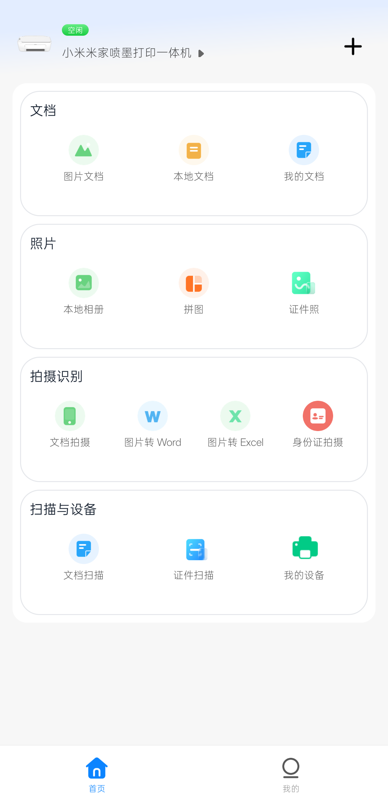
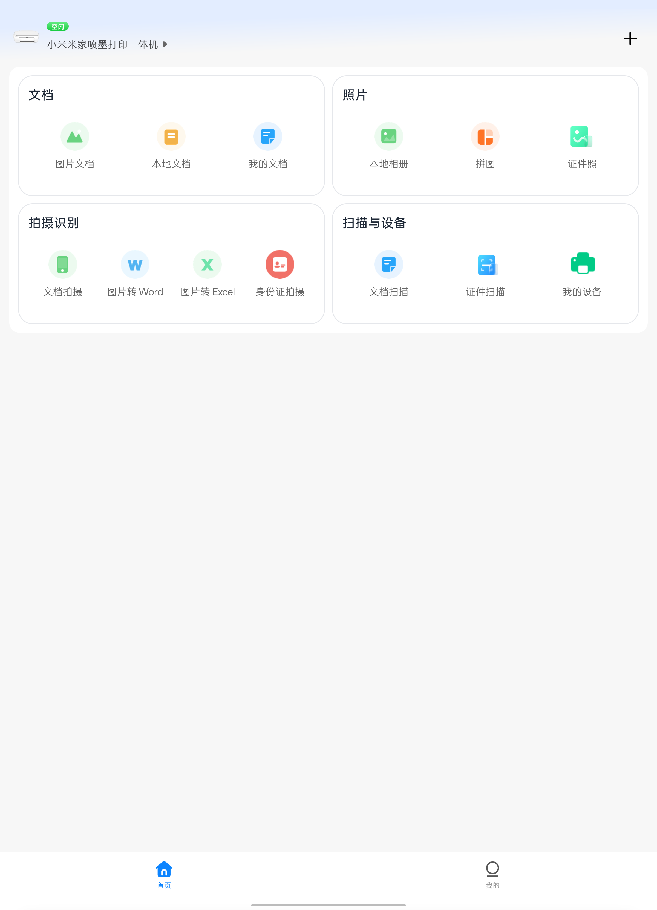

# 小米打印界面精简（XmPrint）

面向小米打印 `4.1.713 (458)` 的 LSPosed 模块，为手机和平板提供响应式任务首页、方向适配和界面精简；打印与扫描仍由小米打印官方功能完成。

## 功能

- 将首页整理为文档、照片、拍摄识别、扫描与设备四个任务分区，共 13 个官方功能入口。
- 根据可用宽度自动切换手机纵向布局和平板双列布局。
- 保留官方 View、监听器和业务路由，不接管打印、扫描、文件选择或设备通信。
- 精简首页课程/资源入口、用户中心与底部导航中的非必要内容。
- 支持小米打印的单应用方向适配。
- 提供模块总开关、LSPosed 连接状态和作用域状态页面。
- 遇到非目标版本或页面结构不匹配时跳过界面 Hook，避免部分重排。

## 实机截图

以下图片来自真实手机和平板，已仅裁去系统状态栏。

| 手机 | 平板 |
|---|---|
|  |  |

## 使用要求

- Android 9.0 及以上（`minSdk 28`）。
- 支持 libxposed API 102 的 LSPosed 环境。
- 目标应用：小米打印 `4.1.713 (458)`，包名 `com.mi.print`。
- 模块作用域仅为 `com.mi.print`。
- LSPosed 所依赖的 Root 环境；模块本身不直接请求 Root 权限。

## 安装

1. 从 [Releases](../../releases) 下载 APK 并安装。
2. 在 LSPosed 中启用“**小米打印界面精简**”。
3. 确认作用域已勾选“小米打印”（`com.mi.print`）。
4. 强行停止并重新打开小米打印，使 Hook 在冷启动时加载。
5. 如需关闭全部界面适配，打开模块设置页并关闭总开关，再冷启动小米打印。

升级时建议直接覆盖安装；不要为升级卸载应用或清除小米打印数据。

## 兼容性

| 项目 | 状态 |
|---|---|
| 小米打印 `4.1.713 (458)` | 支持并已在真实手机、平板验证首页与代表性官方路由 |
| 其他小米打印版本 | 不支持；版本校验失败时模块不会安装界面 Hook |
| 手机/平板响应式布局 | 已在当前真实设备的默认字体环境验证 |
| 极端分屏、大字体和未测试 ROM | 未声明支持 |

本模块只调整界面与入口组织，不提供打印协议、扫描协议或米家设备接入能力，也不改变打印机绑定和任务提交逻辑。

## 构建

需要 JDK 17 和 Android SDK：

```powershell
.\gradlew.bat :app:lintRelease :app:assembleRelease --offline --console=plain
```

APK 输出到 `app/build/outputs/apk/release/app-release.apk`。仓库不包含签名密钥或本地 SDK 配置。

## 版本

- `versionName`: `1.0.0`
- `versionCode`: `1`
- applicationId: `io.github.duoxini.xmprint`

更新内容见 [CHANGELOG.md](CHANGELOG.md)。

## 许可

本仓库目前未声明开源许可证。源代码公开用于查看与审计，并不自动授予复制、修改或再分发许可。
